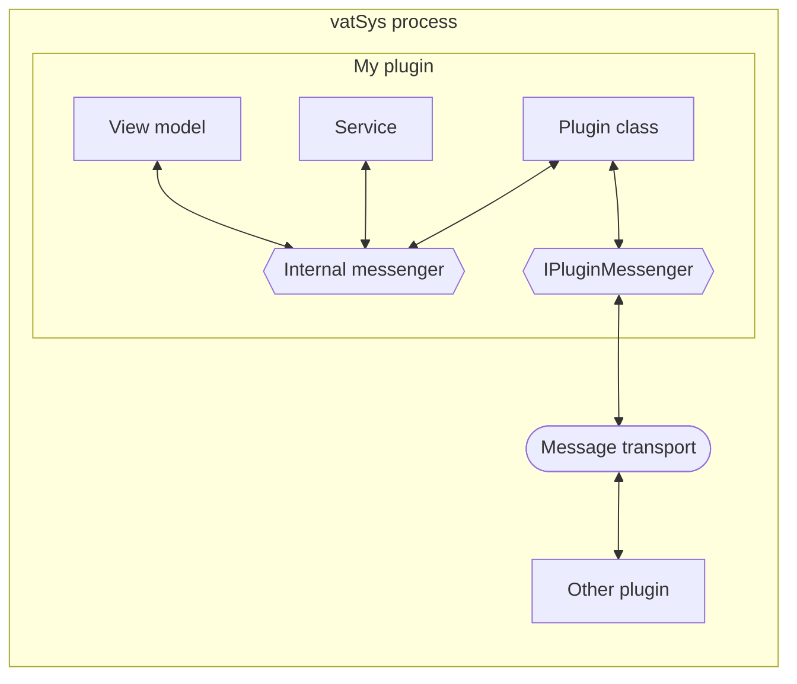

<h1 align="center">
  vatSys Toolbox
</h1>

<h3 align="center">
  A class library that makes it easier to develop vatSys plugins.

  [](https://github.com/YuKitsune/vatSysToolbox/actions/workflows/build.yml)
  [](https://github.com/YuKitsune/vatSysToolbox/blob/main/LICENSE)
  [](https://github.com/YuKitsune/vatSysToolbox/releases)
  [](https://github.com/Fallout-build/Fallout)
</h3>

## Overview

vatSys Toolbox contains the code that many vatSys plugins need. It has these features:

- **[Error reporting](#error-reporting):** Write errors to the log, and show them in the vatSys error window.
- **[Clock](#clock):** Get the current time from a clock that you can replace in tests.
- **[Windows](#windows):** Show WPF views in native vatSys windows.
- **[Styles and controls](#styles-and-controls):** WPF styles and controls inherit the style defined in the loaded vatSys profile.
- **[Background work](#background-work):** Background work and queue abstractions.
- **[Messages between plugins](#messages-between-plugins):** Send messages, requests, and broadcasts to other plugins in the same vatSys process.
- **[Configuration](#configuration):** Find configuration files in the vatSys profile.
- **[DPI awareness](#dpi-awareness):** Make sure that WPF content in vatSys has the correct scale.

Integrations:

- **[MediatR](#mediatr):** Handle the messages from other plugins with MediatR (in the `vatSysToolbox.MediatR` package).

## Installation

The toolbox is available from the GitHub Packages NuGet feed.

1. Make a GitHub personal access token (classic) with the `read:packages` scope.
2. Add the feed to the `nuget.config` file of your plugin:

    ```xml
    <?xml version="1.0" encoding="utf-8"?>
    <configuration>
      <packageSources>
        <add key="YuKitsune" value="https://nuget.pkg.github.com/YuKitsune/index.json" />
      </packageSources>
      <packageSourceCredentials>
        <YuKitsune>
          <add key="Username" value="%GITHUB_USERNAME%" />
          <add key="ClearTextPassword" value="%GITHUB_TOKEN%" />
        </YuKitsune>
      </packageSourceCredentials>
    </configuration>
    ```

3. Add the package to your plugin project:

    ```shell
    dotnet add package vatSysToolbox
    ```

The toolbox targets .NET Framework 4.7.2, and it references `vatSys.exe`. Set the `VatSysPath` MSBuild property to the vatSys installation directory if vatSys is not installed in the default location.

> [!IMPORTANT]
> Merge the toolbox into your plugin assembly (for example, with ILRepack). Other plugins can use different versions of the toolbox. If you do not merge the toolbox, vatSys can load the incorrect version.

## Service collection

Register the features that your plugin uses in a `ServiceCollection` from `Microsoft.Extensions.DependencyInjection`. Each feature has an extension method, and you can chain the calls. You must also register the logging services.

```csharp
var services = new ServiceCollection()
    .AddLogging()
    .AddErrorReporter("My Plugin")                // The name that shows with the errors
    .AddClock()
    .AddWindowManager()
    .AddWorkQueue()
    .AddPluginMessenger("dev.example.my-plugin"); // The mailbox name of your plugin
```

If you do not register an error reporter, the other features ignore their errors.

## Features

In the larger features, **Usage** tells you how to use the feature, and **Notes** has the details that you need only sometimes.

### Error reporting

`IErrorReporter` writes errors to the log, and shows them in the vatSys error window. The error window shows each error message one time each minute at most.

```csharp
errorReporter.ReportError(exception, "Could not load the configuration");
```

### Clock

`IClock` gives the current time in UTC. Use a fake clock in tests.

### Windows

Use `WindowManager` to open a WPF view in a vatSys window. Each is identified by a key.

```csharp
windowManager.OpenOrFocus(
    key: "my-plugin.settings",
    title: "Settings",
    createView: windowHandle => new SettingsView(new SettingsViewModel(windowHandle)),
    new WindowOptions { Size = WindowSize.Absolute(400, 300), CanMinimise = false });
```

- `Open` opens the window.
- `OpenOrFocus` opens the window, or focuses it if it is already open.
- `Toggle` opens the window, or closes it if it is already open. If the window is minimised, `Toggle` focuses it.
- `IsOpen` tells you if the window is open.
- `Close` closes the window.

`WindowOptions` sets these options of the window:

- `Size`: `WindowSize.Content` (the default) gives the window the size of the view, and the user cannot change it. `WindowSize.Absolute(width, height)` gives the window a size that the user can change.
- `CanClose`, `CanMinimise`, and `CanSendToBack` show or hide the close, minimise, and send-to-back buttons.
- `MiddleClickToClose`: a middle-click on the window background closes the window. The default is `false`.
- `MinimumSize` and `MaximumSize` set the limits of the size that the user can give the window. Use them only with `WindowSize.Absolute`.

The view receives an `IWindowHandle`. Give it to the view model, so that the view model can control its window:

- `Focus` and `Close` focus and close the window.
- `Shown` occurs when the window shows for the first time. WPF controls in the window can get the keyboard focus only after this event.
- `Moved` occurs when the window moves.
- `BeforeClose` occurs when the window is about to close. Set `Cancel` to `true` to keep the window open. Some closes cannot be cancelled (for example, when vatSys closes).

Use `ShowPopup` to show a WPF view in a small popup at the mouse cursor. You can provide an offset using `PopupOptions`. The popup has no border or title bar, and it closes when the user clicks outside it. Use the `IWindowHandle` to close the popup from the view or the view model.

```csharp
windowManager.ShowPopup(windowHandle => new MyPopupView(new MyPopupViewModel(windowHandle)));
```

When the window closes, it disposes the view model (the `DataContext` of the view) if the view model is `IDisposable` or `IAsyncDisposable`.

### Styles and controls

Add the styles to the resources of your view:

```xml
<UserControl.Resources>
    <ResourceDictionary>
        <ResourceDictionary.MergedDictionaries>
            <toolbox:SharedResourceDictionary Source="/vatSysToolbox;component/Styles.xaml" />
        </ResourceDictionary.MergedDictionaries>
    </ResourceDictionary>
</UserControl.Resources>
```

`SharedResourceDictionary` loads the styles one time, and shares them between all the views. A normal `ResourceDictionary`
parses the styles again for each view, which makes a window or a popup slow to open.

Use the `VatSysColour` markup extension to get a colour from the vatSys profile:

```xml
<TextBlock Foreground="{toolbox:VatSysColour InteractiveText}" />
```

`VatSysFont` gives the font of the vatSys windows. `Bevel` gives the brushes and the sizes of the vatSys bevels.

The toolbox also contains these controls: `BeveledBorder`, `BeveledLine`, `Chevron`, `CustomScrollBar`, and `TextInput`.

To keep the mouse cursor in a text box while the text box has the keyboard focus, set `CursorCapture.IsEnabled` on a `TextBox`, or `CapturesCursor` on a `TextInput`. The cursor moves to the center of the text box. Enter, Escape, or a middle-click releases the cursor.

```xml
<TextBox controls:CursorCapture.IsEnabled="True" />
<controls:TextInput CapturesCursor="True" />
```

### Background work

`WorkQueue` does work items one at a time, in the sequence that they were added. Work items that change the same state do not need a lock if they use the same queue.

```csharp
workQueue.Enqueue(async () => await UpdateSequence());
```

`BackgroundTask` runs a long-running worker that you can start and stop. Make one for each worker.

### Messages between plugins

`IPluginMessenger` sends messages to other plugins in the same vatSys process. The messages stay in memory.

- `SendAsync` sends a message to one plugin.
- `BroadcastAsync` sends a message to all the other plugins.
- `RequestAsync` sends a request to one plugin, and waits for the reply.
- `Send` and `Broadcast` send a message, but do not wait for the recipient to handle it. If the message cannot be sent, they throw an exception.

The content of a message is optional. If you do not give content, the message has an empty payload and an empty content type.

Each plugin has an inbound queue. If the recipient is not ready, the message stays in its queue until the recipient calls `Start`. Add your handlers before you call `Start`.

```csharp
var json = new JsonMessageSerializer();

messenger.Subscribe("dev.example.my-plugin.sequence-updated", (message, cancellationToken) =>
{
    var sequence = message.Deserialize<Sequence>(json);
    return Task.CompletedTask;
});

messenger.Handle("dev.example.my-plugin.get-sequence", (request, cancellationToken) =>
    Task.FromResult(json.ToContent(GetSequence())));

messenger.Start();

await messenger.BroadcastAsync("dev.example.my-plugin.sequence-updated", sequence, json);
var reply = await messenger.RequestAsync("OtherPlugin", "dev.example.other-plugin.get-status", query, json);
```

Other plugins use the mailbox name of your plugin to send messages to it. Use a reverse DNS name for the mailbox name.

Use a reverse domain name as the prefix of each message type (for example, `dev.example.my-plugin.sequence-updated`). This prevents conflicts between plugins.

The message data is bytes. Each message has a content type, so plugins can use different formats. The toolbox contains `JsonMessageSerializer`. To use a different format (for example, MessagePack), implement `IMessageSerializer`. If a handler accepts more than one format, give all the serializers to `Deserialize`:

```csharp
var sequence = message.Deserialize<Sequence>(json, messagePack);
```

If a plugin receives a direct message or a request that it has no handler for, it logs a warning. The sender of a direct message is not told. The requester of a request receives a `MessagingException`, so that it does not wait forever.

#### Messages inside a plugin

Use `IPluginMessenger` only for messages that go to other plugins, or come from other plugins.
For messages between the components in your plugin (for example, from a view model to the plugin class), use a different messenger.



The two kinds of messages have different properties:

| | `IPluginMessenger` | Internal messenger |
|---|---|---|
| Recipients | Other plugins | Components in the same plugin |
| Data | Bytes, with a content type. You must serialize the data. | .NET objects. |
| Delivery | The message goes into a queue. A background thread handles it later. | The messenger usually calls the handlers immediately, on the same thread. |
| Contract | The message type and the payload are a public contract. Other plugins can depend on them. | You can change the messages at any time. |

The toolbox does not contain an internal messenger. Use the messenger that you prefer. We recommend `WeakReferenceMessenger` from the [CommunityToolkit.Mvvm](https://learn.microsoft.com/dotnet/communitytoolkit/mvvm/messenger) package. You can also use MediatR notifications, or .NET events.

```csharp
// A message inside the plugin
public record WindowOpenedMessage;

// The view model sends the message
WeakReferenceMessenger.Default.Send(new WindowOpenedMessage());

// The plugin class receives the message, and tells the other plugins
WeakReferenceMessenger.Default.Register<Plugin, WindowOpenedMessage>(this, (plugin, _) =>
    plugin._messenger.Broadcast("dev.example.my-plugin.window-opened"));
```

The [Tag List plugin](source/TagListPlugin) uses this pattern.

### Configuration

`ConfigurationLocator` finds a configuration file. It searches these directories in this sequence:

1. `Profile\Plugins\Configs\<Plugin Name>`
2. `Profile\Plugins\Configs`
3. `Profile\Plugins`
4. `Profile`
5. The directory of the plugin assembly

```csharp
var configurationFilePath = ConfigurationLocator.LocateConfigurationFile(this, "MyPlugin.json");
```

### DPI awareness

WPF content in vatSys has the correct scale only if Windows runs vatSys as a DPI-unaware application. Call `DpiAwareness.EnsureDpiAwareness()` when your plugin starts. This method sets the Windows compatibility setting for `vatSys.exe`. If the setting changes, the method restarts vatSys.

## Integrations

### MediatR

The `vatSysToolbox.MediatR` package sends the messages and the requests from other plugins to MediatR handlers. Add the package to your plugin project:

```shell
dotnet add package vatSysToolbox.MediatR
```

The package uses MediatR 12. Merge MediatR into your plugin assembly too.

Connect each message type to a notification or a request:

```csharp
var json = new JsonMessageSerializer();

// All the INotificationHandler<SequenceUpdatedNotification> handlers receive each message
messenger.SubscribeNotification<SequenceUpdatedNotification>("dev.example.other-plugin.sequence-updated", mediator, json);

// The IRequestHandler<GetSequenceRequest, Sequence> handler gives the reply to each request
messenger.HandleRequest<GetSequenceRequest, Sequence>("dev.example.my-plugin.get-sequence", mediator, json);

messenger.Start();
```

You can also put the message type on the handler with an attribute, and connect all the handlers in an assembly:

```csharp
[PluginMessageHandler("dev.example.other-plugin.sequence-updated")]
public class SequenceUpdatedHandler : INotificationHandler<SequenceUpdatedNotification>
{
    public Task Handle(SequenceUpdatedNotification notification, CancellationToken cancellationToken) { ... }
}

[PluginMessageHandler("dev.example.my-plugin.get-sequence")]
public class GetSequenceHandler : IRequestHandler<GetSequenceRequest, Sequence>
{
    public Task<Sequence> Handle(GetSequenceRequest request, CancellationToken cancellationToken) { ... }
}

messenger.SubscribeHandlers(typeof(Plugin).Assembly, mediator, json);
messenger.Start();
```

MediatR publishes a notification to all the handlers of its class. Thus, all the handlers of the notification receive the messages, also the handlers that do not have the attribute.

The serializer converts the payload to the notification or the request, and the response to the reply. The handlers run on the thread of the messenger. Use `IGuiInvoker` to change the UI from a handler (see [The UI thread](#the-ui-thread)).

## The UI thread

vatSys and all the plugins use one UI thread. `IGuiInvoker` does an action on that thread. Do not use `IGuiInvoker` unless you must.

You must use `IGuiInvoker` only if both of these conditions are true:

1. The code can run on a thread that is not the UI thread. For example:
   - `OnFDRUpdate` and `OnRadarTrackUpdate`
   - The `Network` events
   - The plugin messenger handlers and the MediatR handlers
   - `WorkQueue`, `Task.Run`, `System.Timers.Timer`, and code after `ConfigureAwait(false)`
   - Some vatSys events, for example `MMI.SelectedTrackChanged`. These can occur on any thread.
2. The code changes something that must change on the UI thread:
   - A WinForms form or control, or a WPF element. For example, it makes, shows, or closes a window.
   - The state that a WPF view binds to. For example, a view model property or collection.
   - A vatSys menu item, or something that is only for the UI thread, such as a message filter.

Do not use `IGuiInvoker` in these cases:

- **The code always runs on the UI thread.** For example: WinForms and WPF event handlers, menu item clicks, form events, `Application.Idle`, and a `DispatcherTimer`. On the UI thread the action runs immediately, so the call does nothing. Call the code directly, and catch the exceptions, because an exception that is not caught on the UI thread stops vatSys.
- **The code does not change the UI.** For example, it reads or changes plugin data, or it sends a message.
- **A method that you call already goes to the UI thread.** For example, `WindowManager` opens and closes windows on the UI thread.
- **The UI does not change.** Do the checks on the background thread first. For example, if a window shows one aircraft, do not post the updates of the other aircraft.

From a thread that is not the UI thread, each call posts one message to the UI thread. A thread can have a maximum of 10,000 posted messages. If the queue becomes full, the WPF content in vatSys can stop until vatSys restarts. Thus, do not call `IGuiInvoker` for each radar track update or each flight plan update.

## Building

Run the build script from the root of the repository:

```shell
./build.sh Compile
```

The build downloads vatSys if you do not set the `VatSysPath` parameter.
